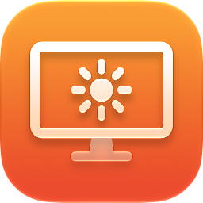
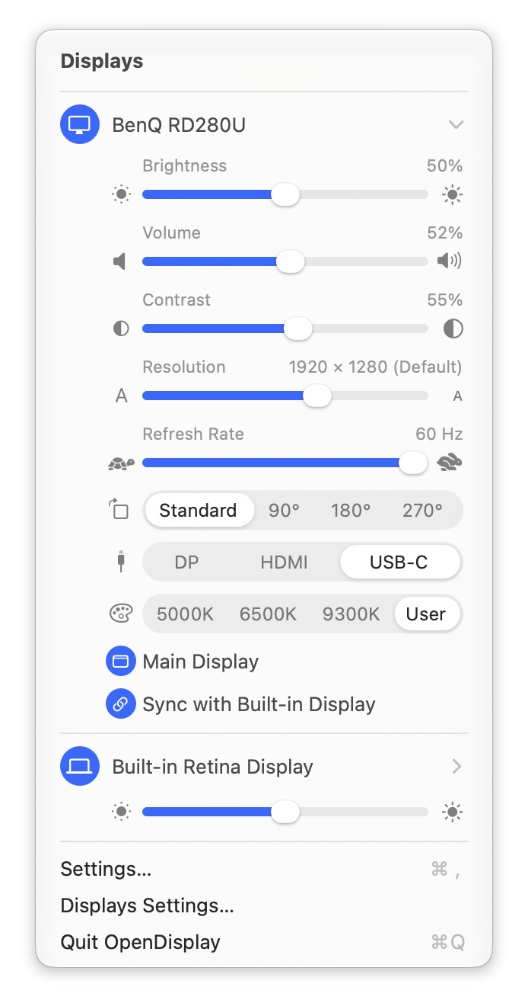
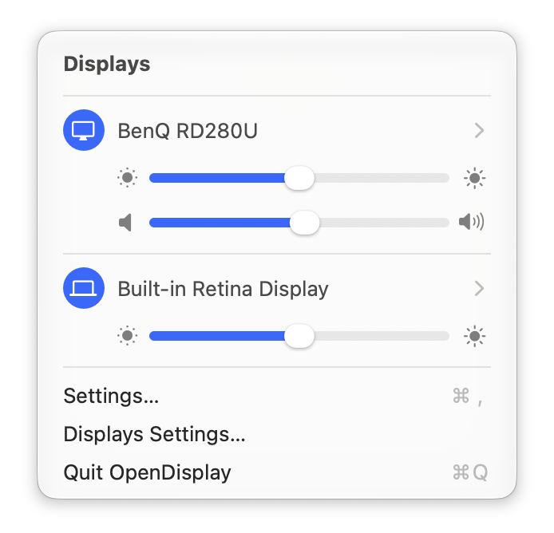
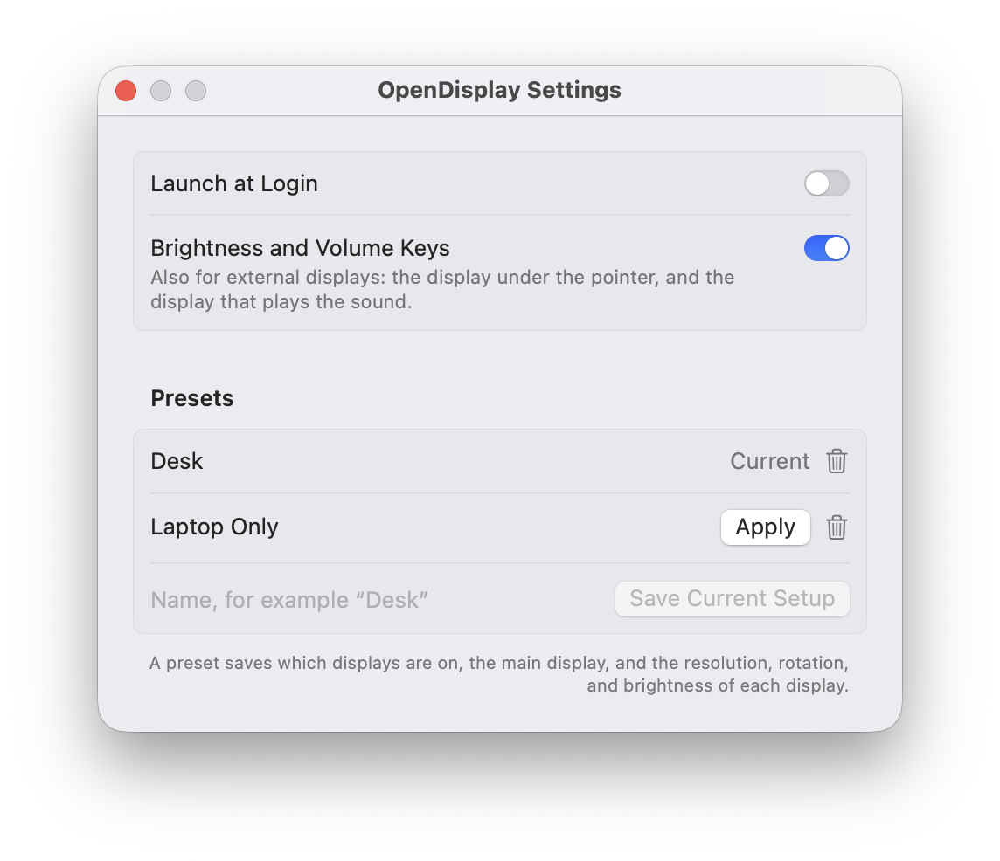

# OpenDisplay

A free macOS menu bar app to control your displays. It looks and works like the system Sound and Wi-Fi menus.

<p align="center">
  <picture>
    <source media="(prefers-color-scheme: dark)" srcset="assets/screenshots/menu-expanded-dark.png">
    
  </picture>
</p>

## Features

- **Brightness** for the built-in display and for external displays (over DDC/CI). All sliders follow the macOS brightness curve, so the displays match. To match them better, calibrate an external display by eye in Settings.
- **Darker than the minimum:** below the lowest backlight level of an external display, the image gets darker in software, down to black.
- **Sync** an external display with the built-in display, so the brightness keys and automatic brightness also change it.
- **Brightness and volume keys** for external displays, with an on-screen indicator.
- **Turn displays on and off** without unplugging them.
- **Volume and mute** for the speakers of external displays.
- **Contrast, input, and color preset** of external displays.
- **Resolution, refresh rate, rotation, and main display.**
- **Extra brightness** for XDR displays: up to 2× the normal maximum.
- **Presets:** save a setup of displays and apply it with one click.
- **Automatic updates:** OpenDisplay checks for new versions once a day ([Sparkle](https://sparkle-project.org)), and asks before it installs one.

## Screenshots

Each display shows only brightness and volume. Click a display to show all its controls. Presets and settings are in a separate window.

<p align="center">
  <picture>
    <source media="(prefers-color-scheme: dark)" srcset="assets/screenshots/menu-dark.png">
    
  </picture>
  <picture>
    <source media="(prefers-color-scheme: dark)" srcset="assets/screenshots/settings-dark.png">
    
  </picture>
</p>

## Requirements

- A Mac with Apple silicon (DDC/CI uses the Apple silicon display interface).
- macOS 14 or later. Some parts need a later version.
- External displays that support DDC/CI for hardware brightness, volume, and input. Other displays get software brightness only.

## Install

1. Download `OpenDisplay-VERSION.zip` from the [latest release](https://github.com/m9tdev/OpenDisplay/releases/latest).
2. Open the zip, and move `OpenDisplay.app` to your Applications folder.
3. Open OpenDisplay. The app is signed and notarized by Apple, so it opens without a warning.
4. For the brightness and volume keys, open Settings (⌘,) in the menu, and click **Allow…** to give OpenDisplay the Accessibility permission.

OpenDisplay is a menu bar app: it has no Dock icon. Look for the display icon in the menu bar.

## Build and install

```sh
scripts/build-app.sh --install
```

This builds `OpenDisplay.app`, copies it to `~/Applications`, and opens it. The script signs the app with your first "Apple Development" certificate, so macOS remembers its permissions after each build. Without a certificate, it signs the app ad hoc.

For the brightness and volume keys, allow OpenDisplay in System Settings → Privacy & Security → Accessibility. The Settings window (⌘,) has a button for this.

### Screenshots

```sh
scripts/make-screenshots.sh
```

This makes the screenshots in `assets/screenshots` again: the menu (short and with all controls) and the Settings window, in light and dark mode. It takes about 30 seconds, and you must not use the mouse or keyboard while it runs. It needs an external display and [Pillow](https://pypi.org/project/pillow/) (`pip3 install pillow`). Afterwards, it restores your settings.

### Releases

```sh
scripts/make-release.sh notes.md
```

This tags the version in `Resources/Info.plist`, with the release notes in `notes.md` as the tag message, and pushes the tag. Raise the version first. The [Release workflow](.github/workflows/release.yml) then builds the app on a GitHub-hosted macOS runner (Xcode 27), signs it with the Developer ID, notarizes it (`scripts/notarize.sh`), and publishes the GitHub release. The release also gets `appcast.xml` (made by `scripts/make-appcast.sh`), the feed that the app reads for automatic updates. Sparkle installs an update only if the zip has a valid signature with the Sparkle key. The signing, notary, and Sparkle keys are secrets of the `release` environment on GitHub, which only `v*` tags can use. The Sparkle key is also in the maintainer's login keychain (Sparkle's `generate_keys`).

To make a notarized build on your own Mac: `SIGN_IDENTITY="Developer ID Application: …" scripts/build-app.sh`, then `scripts/notarize.sh` with `ASC_KEY_ID`, `ASC_ISSUER_ID`, and `ASC_KEY_PATH` set.

To change the app icon, change the geometry in `scripts/make-app-icon.py` and `Sources/OpenDisplay/MenuBarIcon.swift`, then run `scripts/make-app-icon.py`. It makes `Resources/AppIcon.icon`, which `scripts/build-app.sh` compiles with Apple's `actool`.

## How it works

OpenDisplay uses private macOS APIs, because macOS has no public APIs for these features:

- `IOAVService` to send DDC/CI commands to external displays.
- `DisplayServices` for the built-in display brightness and its change notifications.
- `CGSConfigureDisplayEnabled` to turn displays on and off.
- `MonitorPanel` to rotate displays.

The app loads these APIs at runtime. If a macOS update removes one, only the feature that uses it stops working.

## License

MIT
